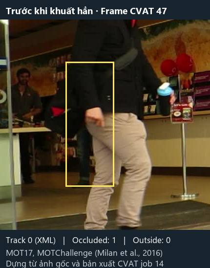
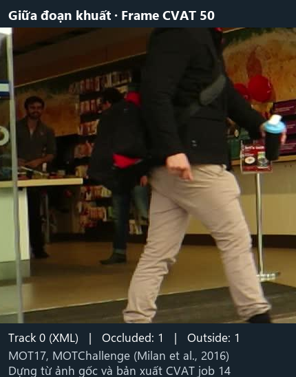
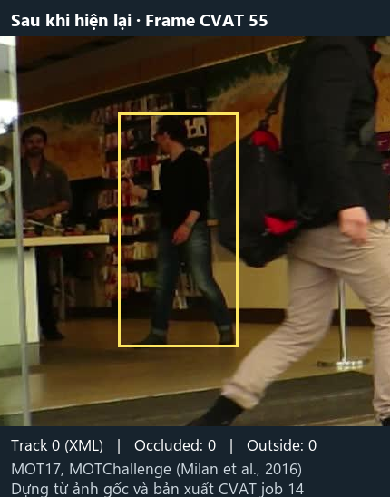

# Báo cáo cá nhân — Đặng Thu Thủy (2A202603263)

Đoạn video: MOT17-09, 150 frame (frame 1–150), nguồn MOTChallenge, giấy phép CC BY-NC-SA 3.0.

## 0. Thông tin học viên

- Họ tên: Đặng Thu Thủy
- MSSV: 2A202603263
- Mã đề (A/B/C): A
- Email: thuythu0965@gmail.com
- Link repository: https://github.com/thuythu0312/K5-L2-Day05-DangThuThuy-03263-MOTTracking
- Giờ bắt đầu: 16h30
- Giờ kết thúc: 19h30

Phân bổ dự kiến trong 180 phút: 16h30–16h45 xem trước, 16h45–18h10 gán track, 18h10–18h30 xử lý che khuất, 18h30–19h00 tự review và 19h00–19h30 xuất file, tự kiểm và hoàn thiện báo cáo.

## 1. Xem trước đoạn video (CP0)

Các mốc dưới đây được đối chiếu lại từ bản xuất của job 14. Số frame theo CVAT (0–149).

| Mã | Frame xuất hiện | Frame cuối thấy được | Rẽ / dừng / đổi tốc độ ở frame | Bị che ở frame | Ghi chú |
|---|---|---|---|---|---|
| P1 | 1 | 149 | Cần xem lại video | 1–47 và 53–54 (che một phần); 48–52 (outside) | Qua đoạn khuất hoàn toàn và nối cùng ID |
| P2 | 61 | 149 | Cần xem lại video | 61–73 | Vừa xuất hiện đã bị che một phần |
| P3 | 0 | 149 | Cần xem lại video | — | Box có mặt xuyên suốt 150 frame |
| P4 | 40 | 149 | Cần xem lại video | — | Đi vào từ mép phải ở frame 40 |
| P5 | 0 | 106 | Cần xem lại video | — | Bật outside từ frame 107 |

## 2. Keyframe và thời gian (CP1, CP4)

Số keyframe lấy từ kết quả `src/check_submission.py`.

| Mã | Số keyframe | Keyframe ở frame | Số frame có mặt | Keyframe / 100 frame | Thời gian (phút) | Chỗ khó |
|---|---|---|---|---|---|---|
| P1 | 64 | 1, 53, 55, 57, 58, 59, 60, 61, 62, 63, 64, 65, 66, 67, 68, 69, 70, 72, 73, 76, 77, 78, 79, 80, 81, 82, 83, 85, 86, 87, 88, 89, 96, 99, 100, 102, 104, 106, 107, 109, 111, 112, 113, 115, 116, 117, 119, 122, 123, 125, 126, 127, 128, 129, 130, 136, 137, 139, 140, 141, 142, 143, 145, 147 | 144 | 44.4 | 22 | Qua đoạn khuất hoàn toàn và nối cùng ID. |
| P2 | 56 | 61, 63, 64, 65, 66, 67, 69, 71, 72, 73, 74, 75, 76, 77, 78, 79, 80, 81, 82, 83, 84, 85, 86, 87, 88, 89, 90, 92, 93, 94, 95, 97, 100, 102, 103, 104, 105, 108, 109, 110, 111, 117, 120, 122, 123, 125, 129, 130, 132, 133, 139, 140, 141, 145, 147, 149 | 89 | 62.9 | 16 | Vừa xuất hiện đã bị che một phần |
| P3 | 128 | 0, 1, 3, 4, 6, 9, 11, 12, 13, 15, 16, 17, 19, 21, 22, 23, 24, 25, 26, 27, 28, 29, 30, 32, 35, 37, 38, 39, 41, 42, 43, 44, 45, 46, 47, 48, 50, 51, 52, 53, 54, 55, 57, 58, 59, 60, 62, 63, 64, 65, 66, 67, 69, 71, 72, 74, 76, 77, 78, 79, 80, 81, 82, 83, 84, 85, 86, 87, 88, 90, 91, 92, 93, 94, 95, 96, 97, 98, 99, 100, 102, 103, 104, 105, 106, 107, 108, 109, 110, 111, 112, 113, 114, 115, 116, 117, 118, 119, 120, 121, 122, 123, 124, 125, 126, 127, 128, 129, 130, 131, 132, 133, 134, 135, 136, 137, 138, 139, 140, 141, 142, 143, 144, 145, 146, 147, 148, 149 | 150 | 85.3 | 19 | Box có mặt xuyên suốt 150 frame |
| P4 | 103 | 40, 41, 42, 43, 44, 45, 47, 48, 49, 50, 53, 54, 55, 56, 57, 58, 59, 60, 61, 62, 63, 64, 65, 66, 67, 68, 69, 70, 71, 72, 73, 74, 75, 76, 77, 78, 79, 80, 82, 84, 86, 87, 88, 89, 91, 92, 93, 94, 95, 96, 97, 98, 99, 100, 101, 102, 103, 104, 105, 106, 107, 108, 109, 110, 111, 112, 113, 114, 115, 116, 117, 118, 119, 120, 121, 122, 123, 124, 125, 126, 127, 128, 129, 130, 131, 132, 133, 134, 135, 136, 137, 138, 139, 140, 141, 142, 143, 144, 145, 146, 147, 148, 149 | 110 | 93.6 | 18 | Đi vào từ mép phải ở frame 40 |
| P5 | 39 | 0, 1, 2, 3, 4, 5, 6, 7, 8, 9, 10, 11, 12, 13, 14, 15, 16, 17, 18, 19, 20, 21, 22, 23, 24, 25, 26, 27, 28, 30, 32, 33, 34, 35, 36, 37, 49, 67, 78 | 107 | 36.4 | 10 | Bật outside từ frame 107 |
| Tổng | 390 | — | 600 | 65,0 | 85 | Thời gian gán theo phân bổ dự kiến |

Keyframe / 100 frame của cả bài = tổng keyframe ÷ tổng số frame có mặt × 100 = 390 ÷ 600 × 100 = 65,0

P3 có nhiều keyframe nhất (128) và xuất hiện suốt 150 frame. P4 có mật độ cao nhất (93,6 keyframe/100 frame). Lý do chọn các mốc cụ thể cần đối chiếu lại với video

## 3. Đoạn bị che (CP2)

Người bị che: `P1` (track 0 trong XML, ID 3 trong MOT).

| Mốc | Frame |
|---|---:|
| Bắt đầu bị che một phần (bật occluded) | 1 (mốc đầu tiên đã gắn cờ trong bản xuất) |
| Mất hẳn (bật outside) | 48 |
| Hiện lại (tắt outside) | 53 |
| Thấy rõ trở lại (tắt occluded) | 55 |

- Thời gian khuất hẳn: 5 frame (48–52) ≈ 0,17 giây ở 30 fps.
- Quyết định: giữ cùng ID.
- Lý do (trả lời 3 câu: khuất bao lâu so với 60 frame, ngoại hình có khớp, chỗ hiện lại có đúng hướng và tốc độ):

Khoảng khuất 5 frame ngắn hơn ngưỡng 60 frame. Box khi xuất hiện lại gần vị trí trước lúc mất và tiếp tục dịch sang phải. Ngoại hình và tốc độ cần đối chiếu trực tiếp trên video

Ảnh cắt minh họa dựng từ frame MOT17 và bản xuất CVAT:





## 4. Tự review ID (CP3)

Lượt 1 theo người (đi ngược từ frame 149 về 0 trên CVAT), lượt 2 theo cảnh (nhảy 10 frame). Ít nhất 3 dòng; không có lỗi thì ghi một dòng đã kiểm hai lượt, không lỗi

Loại lỗi dùng đúng một trong 7 mã: id_switch, fragmentation, lost, merge, false_track, drift, flag

Mốc đối chiếu từ bản xuất job 14

- Lượt 1, theo từng người từ frame 149 về 0. Kiểm tra P1 tại 47–55: bản xuất giữ cùng ID trước và sau đoạn outside 48–52. Kiểm tra box P1 bám đúng người khi hiện lại ở frame 53
- Lượt 2, theo cảnh ở các frame 0, 10, 20, …, 140 và 149. Dừng thêm tại frame 40 khi P4 vào từ mép phải, frame 61 khi P2 xuất hiện và frame 107 khi P5 được bật outside. Kiểm tra có người bị bỏ sót, box trùng hoặc ID đổi giữa hai người đi gần nhau

Điền bảng theo quan sát trên CVAT và ghi tình trạng sửa sau khi kiểm tra từng lỗi.

**Kiểm tra hỗ trợ trên CVAT job 14**

- Lượt 1 (theo ID): đối chiếu danh sách Objects ở các mốc đi ngược từ 149 về 0. Soi thêm hình ở frame 47, 50, 53 và 55. Bản xuất ghi P1 giữ cùng ID qua đoạn outside 48–52
- Lượt 2 (theo cảnh): đối chiếu danh sách Objects ở 0, 10, …, 140 và 149. Soi thêm hình quanh các mốc 40, 61 và 107. Danh sách Objects có thể vẫn giữ track ở frame đặt cờ outside, nên cần đối chiếu cờ và box để xác định track có mặt.

Phạm vi kiểm tra là danh sách track tại các mốc và hình ở một số frame chuyển tiếp. Phần dưới ghi kết quả của Codex hỗ trợ kiểm tra.

| Frame | Mã người | Loại lỗi | Mô tả một câu | Phát hiện ở lượt | Đã sửa? |
|---:|---|---|---|---|---|
| — | — | — | Chưa xác nhận lỗi ID tại các mốc đối chiếu | Kiểm tra hỗ trợ | — |

Số lỗi đã xác nhận theo loại trong phạm vi các mốc kiểm tra hỗ trợ

| `id_switch` | `fragmentation` | `lost` | `merge` | `false_track` | `drift` | `flag` |
|---:|---:|---:|---:|---:|---:|---:|
| 0 | 0 | 0 | 0 | 0 | 0 | 0 |

Lỗi nào chỉ lượt 2 (theo cảnh) mới thấy, lượt 1 (theo người) không thấy? Vì sao?

Ở các mốc đã đối chiếu, lượt 2 chưa ghi nhận thêm lỗi so với lượt 1. Lượt 2 dùng danh sách Objects để đối chiếu các track cùng xuất hiện và dùng hình tại một số mốc chuyển tiếp để kiểm tra box trong bối cảnh cả cảnh.

## 5. File xuất và kết quả tự kiểm (CP4)

| Kiểm tra | Kết quả |
|---|---|
| Tên file MOT 1.1 | DangThuThuy_mot.zip |
| Tên file CVAT for video 1.1 | DangThuThuy_cvat_video.zip |
| Số track ID khác nhau trong gt/gt.txt (phải là 5) | 5 |
| Frame outside không có dòng trong gt.txt (đúng / sai) | Đúng, đối chiếu tập frame có mặt của cả 5 track |
| Job đã completed trên CVAT máy cá nhân | Cần xác nhận trên [job 14](http://localhost:8080/tasks/14/jobs/14) |

Dán phần tóm tắt in ra từ src/check_submission.py:

```text
=== Tóm tắt ===
  Lỗi: 0   |   Cảnh báo: 3
  Không có lỗi định dạng. Mở CVAT xem lại từng [CẢNH BÁO]; cảnh báo đúng ý bạn thì ghi lý do vào báo cáo
```

Ba cảnh báo về mật độ keyframe: P2 (62,9), P3 (85,3) và P4 (93,6 keyframe/100 frame)

## 6. Ba câu kết

1. Nếu được gán lại, bạn sẽ đặt keyframe khác ở đâu? Vì sao?

   Mốc để cân nhắc: P4 có 103 keyframe trên 110 frame. Xem lại đoạn 99–149 và ghi mốc cụ thể mà nội suy vẫn bám người sau khi giảm keyframe

2. Có chỗ nào bạn không chắc "cùng ID hay ID mới"? Bạn đã quyết định và ghi chú thế nào?

   Mốc để đối chiếu: P1 ở frame 47–55. Bản xuất giữ cùng ID qua 5 frame khuất. Bổ sung chỗ bạn thực sự phân vân, nếu có, và dấu hiệu bạn đã dùng để nhận diện

3. Một lỗi ID trong job của bạn (nếu không còn sót, chọn lỗi đã sửa) có thể làm xe tự lái dự đoán sai chuyển động của người đó như thế nào? Lỗi đó ảnh hưởng MOTA hay IDF1 nhiều hơn?

   Chọn một lỗi thật đã xác nhận ở mục 4. Nếu lỗi là đổi ID, việc ghép quỹ đạo của hai người có thể làm sai hướng hoặc tốc độ ước lượng. MOTA tính lần đổi ID vào tổng lỗi, còn IDF1 phản ánh số frame được ghép đúng danh tính

## 7. Tài liệu tham khảo và công cụ AI đã dùng

- MOT17, MOTChallenge (Milan et al., 2016)
- CVAT Community, job 14 và hai bản xuất MOT 1.1, CVAT for video 1.1
- Codex hỗ trợ trích thống kê từ bản xuất, chạy script tự kiểm, dựng ảnh minh họa và điền các phần dựa trên dữ liệu
